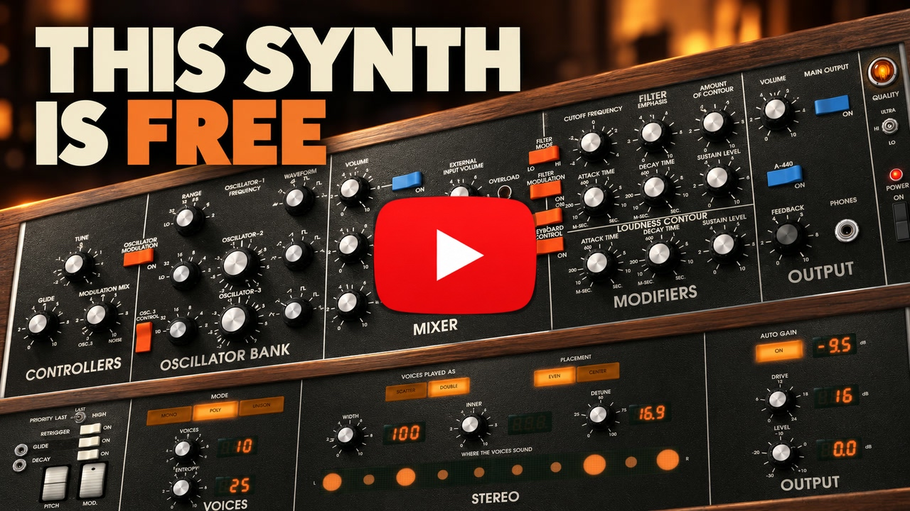
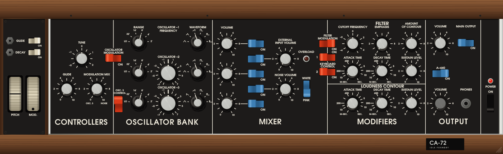

# CA-72

A synthesizer for macOS, Windows and Linux, as a standalone application, VST3 and CLAP
plug-in, and an Audio Unit for macOS, by Idle Foundry:
monophonic like the instrument it models, or one whole instrument per note with POLY. Its
voice is modelled from the circuit of a 1970s analogue synthesizer, the
Minimoog Model D of about 1972-73 with the CA3046 ("old") oscillator board. Every board
was transcribed from the instrument's service documents into SPICE netlists and simulated
in ngspice. The real-time models were then derived from those simulations and tested
against them, the factory calibration procedures included.

[](https://youtu.be/QLfwGqYg4wU)

Hear it before you download: [the CA-72 on YouTube](https://youtu.be/QLfwGqYg4wU).

It is free software under the GNU General Public License, version 3 or later. Copyright ©
2026 Idle Foundry Ltd.

**Status:** 0.2.6: same sound, lighter on your computer: output bit-identical to 0.2.5, HI up to
17 % lighter on a Mac and 9 % on Windows and Linux, smoother with several instances, and a panel
that rests while you can't see it. Includes 0.2.5: a new instance starts at QUALITY LO, the light voices (projects keep their
own; 0.1's open at HI), and on macOS the pointer shows resize arrows over the grip. Includes
0.2.4: LETTERING › LARGE in the settings menu prints the panel's lettering and
the menus a size larger, and WINDOW › SIZE… sets the window's size; the resize grip can be
seen. Includes 0.2.3: a standalone application with audio and MIDI selection, a playable lower
keyboard, and independent computer-keyboard octaves. Includes 0.2.2: PANEL shows or hides the
lower controls; strong filter contours
in HI and LO keep ultrasonic resonance out of the output. Both modes use more CPU and their
renders change; ULTRA is unchanged. Includes 0.2.0: the circuit calibrated against a hardware instrument, projects saved with
0.1 translated into it; nineteen new factory presets, 0.1's in a download of their own; the
realistic look; QUALITY's LO, HI and ULTRA; stereo with SPREAD, INNER, DOUBLE and UNISON;
DRIVE, LEVEL and AUTO GAIN; FILTER MODE; NOTE PRIORITY and RETRIGGER; and an instance waiting
costs next to nothing. The macOS installer is signed and notarised; the Windows one is not yet
signed.

## Installing

1. Download the installer for your computer from the
   [latest release](https://github.com/idlefoundry/ca-72/releases/latest):

   | Computer | Download |
   |---|---|
   | macOS 11 or later, Apple silicon or Intel | `CA-72-<version>-macOS.pkg` |
   | Windows 10 or 11, 64-bit | `CA-72-<version>-Windows-setup.exe` |
   | Linux, x86-64 (Ubuntu 22.04, Debian 12, Fedora 36 or later, or Arch) | `CA-72-<version>-Linux-x86_64.tar.gz` |

2. Run it. On Linux, unpack it and run the script in its folder:

   ```sh
   tar xzf CA-72-<version>-Linux-x86_64.tar.gz
   cd CA-72-<version>-Linux-x86_64
   ./install.sh
   ```

3. In your host, rescan the plug-ins or restart it. The CA-72 appears as an instrument by
   Idle Foundry, in VST3 and CLAP, and on macOS as an Audio Unit too (in Logic Pro and
   GarageBand, under **AU Instruments › Idle Foundry**). The macOS installer has the Audio
   Unit from 0.1.2 on.

The Windows installer is not yet signed, so the first time you run it Windows says "Windows
protected your PC": click **More info**, then **Run anyway**. To install by hand instead,
each release from 0.1.5 has `CA-72-<version>-Windows-x86_64.zip`: the same VST3 and CLAP, with
a `README.txt` that says where to copy them. From 0.2.3, the installers and Windows ZIP
also include the standalone application.

The plug-ins go into the usual folders:

| | VST3 | CLAP | Audio Unit |
|---|---|---|---|
| macOS | `/Library/Audio/Plug-Ins/VST3` | `/Library/Audio/Plug-Ins/CLAP` | `/Library/Audio/Plug-Ins/Components` |
| Windows | `C:\Program Files\Common Files\VST3` | `C:\Program Files\Common Files\CLAP` | |
| Linux | `~/.vst3` (`/usr/lib/vst3` with `./install.sh --system`) | `~/.clap` (`/usr/lib/clap`) | |

**Choosing a folder or external drive.** The standalone application and its licence files can
live elsewhere. The installers keep plug-ins in the folders above so hosts can find them.
Factory sounds and artwork are built into the binaries; there is no separate sound library
to move. Your own presets, settings and standalone session stay in your user profile.

- **Windows:** choose the app folder on **Select Destination Location**. The default is
  `C:\Program Files\Idle Foundry\CA-72`; the licences and uninstaller also go there, even
  if you select only plug-ins. Updates remember the folder and show it again. To move an
  existing installation, uninstall it first, then run the installer and choose the new
  folder. If an external drive is disconnected, the app and its uninstaller cannot launch;
  an update stops until you reconnect it with the same drive letter. Installed plug-ins
  continue to work from the system drive.
- **macOS:** the package installs the app in `/Applications`. Move `CA-72.app` in Finder to
  your chosen folder or external drive, keeping the bundle whole. The drive must be connected
  to run it. Updates put a new copy in `/Applications`; quit the app, replace your moved copy
  with the new one and open that copy. VST3, CLAP and Audio Unit stay in `/Library/Audio/Plug-Ins`.
- **Linux:** mount the drive, create a folder on it, then run
  `./install.sh --prefix "/media/you/SSD/CA-72"` with that existing absolute folder. This puts
  the app in its `bin` subfolder and licences in `share`; the menu entry and icon stay in your
  usual desktop folders. Add `--standalone-only` to omit plug-ins, or `--system` for a
  system-wide installation. Reuse the same flags and prefix to update or uninstall. A missing
  or read-only destination folder stops installation before any plug-ins are replaced; check
  the drive is mounted, writable, at the same path first. The app cannot launch while it is disconnected. `--prefix`
  applies only to the standalone; it does not change the plug-in folders or your `PATH`.
  Use a subfolder on the drive rather than its mount point: the empty mount-point directory
  can remain after disconnecting, and the script cannot distinguish it from a local folder.
  If an older script installed plug-ins beneath a custom prefix, uninstall those copies
  with that script first.

To uninstall: on macOS, delete `CA-72.vst3`, `CA-72.clap` and `CA-72.component` from those
folders and `CA-72.app` from wherever you keep it; on Windows,
find **CA-72** in **Settings › Apps** and choose **Uninstall**; on Linux, run
`./install.sh --uninstall` (`./install.sh --uninstall --system` for a system-wide copy). Your
presets, settings and standalone session are kept.

**Updating.** Open the presets' drawer (click the preset's name under the panel) and click
**[ CHECK FOR UPDATES ]** at the foot of the PRESET display, under the version you have. If a
newer release is out, **[ DOWNLOAD ]** opens its installer for your computer in your browser:
close your host, then run it as above. The CA-72 checks only when you click, through your system's `curl`,
and sends nothing of yours.

Settings also has **WHAT'S NEW…**, which opens this version's bundled highlights without
an internet connection, in a dialog over the panel; **GOT IT** or Escape closes it. The first
visible editor after an install or update shows them automatically, once for your OS user
on that computer. When an earlier shown version is
known, that automatic view includes the available intervening releases. Settings always
reopens the current release's highlights.

## Playing it

The keyboard button beside SAVE and settings switches the lower panel between
VOICES/STEREO/OUTPUT and a playable 44-key keyboard. The wheels, GLIDE and DECAY
remain visible. Click a key or drag between keys to play; the octave buttons move
the visible range. In standalone, TYPING enables a piano layout on your computer keyboard: `A S D F G`
play `C D E F G`, with `W E T Y U` on the black notes. The full chromatic order is
`A W S E D F T G Y H U J K O L P ;`. A starts at C3 (MIDI 48); `Z` lowers TYPING
one octave and `X` raises it. TYPING's octave is independent of the visible range
and the sound's oscillator RANGE controls, and is remembered on this computer.
The TYPING header shows A's current note. Shifting releases held TYPING notes while
pointer and physical MIDI notes continue. TYPING starts off; text entry takes precedence.
TYPING and PANIC appear only in standalone; plug-ins leave computer-keyboard input
to the DAW. PANIC releases notes without changing
the sound. TYPING stays enabled when you show the extra controls or hide the lower
panel; pointer notes release while typed and physical MIDI notes continue. Focus
loss releases local notes. The default range is F2–C6, MIDI 41–84, middle C at MIDI 60.

## Standalone application

The installers include the same instrument as an optional desktop application.
On macOS it installs as `/Applications/CA-72.app`; on Windows, open **CA-72**
from the Start menu; on Linux, use its desktop entry or `ca72-standalone`.

Build it with `scripts/standalone.sh`. It produces `target/bundled/CA-72.app` on
macOS, `target/bundled/CA-72.exe` on Windows, or `target/bundled/ca72-standalone`
on Linux. Run it directly, or package it with the plug-ins using `scripts/package.sh`.
The installer lets you choose the standalone alongside the plug-in formats.
A fresh standalone session opens with the lower keyboard visible; a fresh plug-in
instance opens with the extra controls. The keyboard/controls preference is shared
on this computer, and the panel's expanded state is saved with the session or project.
Linux also accepts `./install.sh --standalone-only` or `--plugins-only`.

Open **Audio & MIDI** from the editor's settings button. Choose your output and
channel pair, sample rate, buffer size and MIDI input(s), then Apply. When no
settings have changed, Done closes the dialog without restarting audio. External
audio input is disabled initially. The display reports the actual callback size
and its buffer duration in milliseconds; that is one component of playing latency.
Cancel discards changes that have not been applied. Refresh checks the device list.
New sessions use **Automatic** MIDI: the first available input with an unambiguous
name is selected and remembered. Open **MIDI INPUTS** to choose Automatic, disable
hardware MIDI, or check specific inputs; click outside the list and Apply.
Existing sessions retain their choices, including disabled MIDI. To enable the new
default in an existing session, choose **Automatic (first available input)** and Apply
once. Open selectors update as devices arrive or disappear. Discovery errors keep
the last good MIDI list and appear in settings; a successful empty inventory reports
that no inputs are available. Refresh retries discovery.
Input/output changes briefly stop playback and retain the sound and editor.

CoreAudio (macOS), WASAPI (Windows) and ALSA (Linux) are the native backends.
The development JACK launcher is kept separately (Building); direct ASIO and
native PipeWire are not included in the production host. External input and output
must support a common nominal sample rate. A bounded capture reservoir adapts
the input to the output clock, so separately enumerated capture/playback endpoints
are supported. The reservoir adds input buffering; the displayed output buffer
duration is not the full input-to-output latency.

The standalone's window is the panel's size: resize it with the grip at the panel's corner
or the settings button's WINDOW › SIZE. On Windows it opens at the scale of the main
display, and its frame cannot be dragged or maximized.

Quit it as any application on your system: Command-Q or the CA-72 menu's Quit on macOS (or
the Dock's Quit, or Command-W, which closes its window), Alt+F4 on Windows, Ctrl+Q on Linux,
or the window's close button. These work while the editor has the keyboard (TYPING, a name
or value being typed) and never play a note; each saves the session as the app closes.

The standalone remembers unsaved edits, MIDI Learn, window size and the last
working audio/MIDI choices in `CA-72/Standalone/session.json` beneath the same
application-data folder as your presets. Held notes and live wheels are not
restored. Presets remain shared with the plug-in. A broken or newer session file
is preserved and reported. Uninstalling keeps presets and the standalone session.

For an isolated editor test, use `ca72-standalone --no-devices --state-dir PATH`;
this opens no audio or MIDI hardware. The implementation contract and its evidence
are [standalone-spec.md](docs/standalone-spec.md) and
[standalone-progress.md](docs/standalone-progress.md).

## Instrument controls



- **Keys:** every MIDI note plays. Notes 41 to 84 are the instrument's 44 keys, F to C
  (with RANGE at 8'); beyond them the plug-in continues the key string's scale, a key a
  semitone, which the instrument cannot do. Like the instrument, the keyboard gives the
  lowest note held priority and triggers once while keys are held. Far above the keys
  (with RANGE, FREQUENCY and the PITCH wheel high as well) an oscillator stops rising, far
  past the audio band.
- **POLY** (under the panel, not the instrument's): off, the one instrument as above. On,
  each note plays a whole instrument of its own, with its own keyboard circuit, contours
  and glide, up to VOICES of them (2 to 10). A new note takes the voice that last played
  its key if that one is free or letting go (a chord struck again stays where it was), else
  the free voice whose last note began longest ago (the notes go round the voices), else the
  one let go longest ago, else the one held longest; a voice that was still held lifts its
  key and presses the new one 13 ms later, so its contours start again (the circuit re-arms
  its trigger only after about 12 ms, and so the note's pitch and attack come 13 ms
  late). The wheels reach every voice. Switching POLY stops the notes sounding.
- **UNISON** (off by default): every note on VOICES whole instruments at once, each taking
  the keys as the one instrument does (the lowest note held, triggering once), each with
  its own parts under ENTROPY and its own place under SPREAD, their oscillators at
  different points of their cycles; turned down so that it sounds about as loud as one
  voice. It outranks POLY. Switching it, or VOICES while it is on, stops the notes
  sounding. With POLY and UNISON off, VOICES counts only as the one voice's places (SPREAD,
  below); with DOUBLE on or WIDTH at 0 it changes nothing, and is dimmed and does not turn,
  as DETUNE is without DOUBLE.
- **ENTROPY** (0 to 100 %, 5 % by default): each voice its own parts, as if built from a
  different batch. At 5 % the oscillators have the small tuning mismatch, slow drift and
  waver that previous versions had at 0 %. Below 5 % these fall linearly to steady pitch
  at 0 %. Above 5 % the previous range continues: the filter's cutoff and EMPHASIS, the
  contours' times and GLIDE vary between voices too. The host parameter **Lock** removes
  the oscillator mismatch and movement at any amount, with its existing level match.
  The panel's deliberate pitch modulation remains available, including noise modulation.
  Older presets and projects move to the equivalent new value when loaded. A DAW's
  automation lanes keep their normalised positions and play the new mapping.
- **SPREAD** (0 to 100 %, off by default): POLY's or UNISON's voices across the stereo
  field, each as loud wherever it sits, where **SCATTER** puts them: EVEN (the default),
  evenly from edge to edge, the first two at the edges; or CENTER, the first in the centre and
  the rest spread about it by the golden ratio. With POLY, UNISON and DOUBLE off the one voice
  goes round VOICES's places, the next at each attack: a note played detached moves on, a note
  played legato stays where its phrase began (with RETRIGGER every key moves on), so a line
  jumps about the field in a pattern the playing makes. All Notes Off, or the host resetting
  the plug-in, starts the pattern again from the first place. A voice moves to a new place
  over 10 ms; the one voice in about 1.6 ms, within the 7.8 ms its contours take to start
  after a key, so that a note is heard where it sounds.
- **INNER** (0 to 100 %, off by default): the inner edge of each side, as a share of SPREAD
  (the strip's WIDTH). SPREAD brings the voices in from the outer edges; INNER moves them out
  from the centre. Each side's voices sit in a band from INNER's share of SPREAD's way out to
  SPREAD's edge, as far across it as SCATTER puts them, and none in the centre: a voice SCATTER
  puts there (CENTER's first, EVEN's last with an odd number of voices) goes to the side its
  turn falls on. With DOUBLE the pairs keep to the band too. At 100 % every voice sits at
  SPREAD's edge; at SPREAD 0 it does nothing.
- **DOUBLE** (the strip's VOICES PLAYED AS: SCATTER by default, or DOUBLE): each note two
  whole voices, DETUNE apart (0 to 100 cents, a semitone at its top), the sharper on the left;
  with SCATTER, DETUNE is dimmed and does nothing. With SPREAD the pair goes out to either side of the centre, as
  far as SCATTER puts the note's voice (with INNER at 100 %, and with POLY and UNISON off, all
  of SPREAD's way); at SPREAD 0 both are in the centre. Turned down so that it sounds about as
  loud as one voice a note; it doubles the voices' work. Switching it on or off stops the
  notes sounding; a doubled voice let go plays its tail out.
- **DRIVE** (0 to 24 dB, off by default): the mixer's signal raised into the filter's input,
  driving it harder than the panel's mixer can. The sound grows louder, by less the higher
  DRIVE goes as the filter's input saturates, and darker: the filter's stages take the highs
  the clipping adds. **AUTO GAIN** (on by default) turns the output down by as much as DRIVE
  made the sound louder. The plug-in measures each sound when you change it in its window
  (three short notes at each of DRIVE's steps, a few tenths of a second's work on a thread of
  its own) and keeps the result with your session, so that it plays and renders the same
  again. A sound set only by the host or a MIDI controller uses the factory presets' average
  until it is changed in the window.
- **LEVEL** (-30 to +12 dB, 0 by default): the output's gain, after MAIN OUTPUT's.
- **Wheels:** MIDI pitch bend moves the pitch by MIDI BEND RANGE semitones (2 by
  default). SETTINGS > MOD WHEEL SOURCE chooses what moves the MODULATION wheel: CC 1
  by default, another available CC, channel aftertouch, or the strongest polyphonic
  aftertouch of the notes held. The common choices include breath (CC 2), foot (CC 4),
  expression (CC 11) and timbre (CC 74); OTHER… reaches the other available numbers.
  The source follows any MIDI channel and stays on this computer, outside presets and
  projects. Changing it clears the old MIDI value. All sound off,
  reset all controllers and all notes off (CC 120, 121 and 123) are followed.
- **External input:** the host's side chain is the panel's EXTERNAL INPUT, through its
  MIXER switch and VOLUME.
- **Output:** stereo, the same on both channels unless SPREAD places the voices or DOUBLE's
  pairs; on a mono output, the two channels together.
- **FEEDBACK** (the phones' VOLUME knob, 0 by default): the instrument has no overdrive
  control; players cable its PHONES output into EXTERNAL INPUT. This knob is that cable:
  turn it up, switch the MIXER's EXTERNAL INPUT on and raise its VOLUME, and the output
  overdrives the external input's preamplifier and the mixer (OVERLOAD lights). With it on
  a voice costs about a fifth more.
- **FILTER MODE** (at the head of the filter's switch column, LO by default): the original
  has no such switch; a modern recreation of the instrument has, and this is its high-pass,
  measured on one. At HI the output is the mixer's less the filter's: about 6 dB an octave
  below the cutoff, the deepest bass coming back, and as EMPHASIS rises, a shelf with the
  resonance's peak on it rather than a high-pass. At LO the filter is the drawing's.
- **POWER** is the host's bypass: the output fades out over 10 ms and back in.
- **QUALITY** (a chrome toggle above POWER: ULTRA, HI, or LO, LO by default for a new
  instance from 0.2.5, HI before; projects keep theirs, those from 0.1 open at HI; not the
  instrument's): at ULTRA the circuit's model plays with no compromises, its most exact, at
  high CPU cost; in 0.2.0 it took about seven times the work of HI, with one voice using
  about a whole core of a fast computer, so
  it is meant for offline renders (export, bounce, freeze) and small projects on powerful
  computers. Choosing it, a shutter in the panel above opens and a lamp comes up and lights
  (or, chosen with a right click on the lamp, ALWAYS OPEN: the lamp stays up and only its
  light comes and goes); the first time, a
  note says what ULTRA is for. At LO, Potato mode, the
  voices are played by a light model instead of the circuit's, for computers the circuit is
  too heavy for. It follows the same panel, the plug-in's own controls with it, its laws
  fitted to the circuit's (pitch, levels, the filter's cutoff, emphasis and rings, the
  contours, GLIDE, the VCA, DRIVE and FILTER MODE), and sounds close to it but simpler: ten
  voices were a thirtieth to a fortieth of HI's cost in the 0.2.0 measurements. The 0.2.2
  filter fixes increase both LO and HI's cost; those earlier ratios no longer describe this
  release. Switching it stops the notes
  sounding (switching between HI and ULTRA does not). It is saved with the session, not with
  presets: it suits the computer, not the sound.

The editor works like the panel:

- **Knobs:** drag up or down, or use the mouse wheel. Hold Shift to turn finely, and
  double-click to return a control to its default.
- **RANGE and WAVEFORM:** drag or scroll, click either side to step, or click a printed
  position to go straight to it.
- **Switches:** click.
- **Wheels:** drag. The PITCH wheel settles into its centre detent when let go near it.
- **Size:** the editor opens at 80 % of the screen's usable width. Drag the grip at the
  bottom right corner to change it, or choose a size from the settings key's **WINDOW ›
  SIZE…**: 75 % to 200 % of the size it opens at on a 1920 by 1080 screen, or **FIT TO
  SCREEN**. Sizes too large for the screen can't be chosen. The panel keeps its proportions,
  and a size you set is saved with the session.

Hovering over a control shows its name and value.

**Oscillators 2 and 3's FREQUENCY** read in semitones: each mark of the dial is a semitone
from the oscillator's centre, -7.5 to +7.5 at the stops, and the knob's tip says where it
stands (cents under a semitone). The settings key (the gear at the strip's right end) offers
**FREQUENCY DIALS › HARDWARE** instead: the knob as the hardware reference's turns, its marks
wider than a semitone near the centre and narrower towards the stops, which reach 8 to 8.6
semitones. The choice is the computer's, not the sound's: a session or preset keeps its pitch
whichever is chosen; only where the knob points changes.

**Lettering.** If the panel's print is hard to read at the size the editor opens, choose
**LETTERING › LARGE** from the settings key. It prints the panel's and the strip's legends and
numbers a size larger, and the menus and tips a quarter larger, in either look. **STANDARD**,
the default, is the panel as printed. The choice is the computer's, kept like the look.

Under the panel, a strip holds the presets' selector and the plug-in's own controls (not the
instrument's): POLY (click), VOICES (click either side to step), and ENTROPY and SPREAD (drag
the slider; the switch beside each turns it off and back on at its amount). VOICES and the
placement are unlit in MONO with DOUBLE, where they move nothing, and FEEDBACK is dimmed
while EXTERNAL INPUT is closed.

**The lower panel.** PANEL beside the settings key shows or hides the lower panel's controls.
The window changes height immediately, with the synth and preset rail always visible; your
choice is saved with the project. Opening presets reveals a hidden panel temporarily, and
closing them returns to the short window.

**Presets.** At the strip's left: the preset last chosen (marked • once you change it), a
star to make it a favourite, the previous and next preset, and SAVE…. A preset holds every
control but the PITCH wheel, POWER and MIDI BEND RANGE (your keyboard's, which choosing a
preset leaves as it is), POLY, VOICES, ENTROPY, SPREAD and INNER among them. Click
the name and a drawer drops down over the strip, in three sections:

- **FIND**: type to search names, descriptions and tags; click a tag to filter by it (the
  wheel scrolls the tags).
- **PRESETS**: ALL, FAVORITES and MINE over the list. Click a preset, or use the arrow keys,
  to choose it; double-click it to choose it and close the drawer; click its star to make it a
  favourite. The mouse wheel or a trackpad scrolls the list.
- **PRESET**: its keys act on the preset you have chosen: RENAME, TAGS, DELETE (asked first:
  DELETE again or Enter deletes it) and, for a factory preset you edited, REVERT. SAVE AS
  saves the current sound, named and tagged (Tab moves from the name to the tags; SAVE AS
  again or Enter saves); naming it as a factory preset saves yours in its place. Names are
  told apart regardless of case, and a few cannot be used on any system: `factory`, and
  Windows' device names such as `CON`. The display under the keys shows the preset, or what
  you are typing.
- Factory presets are never lost: deleting one hides it, and RESTORE brings it back.
- Enter commits a field (in the search, closes the drawer); Escape takes back what a key
  began, or closes it. While the drawer is open it takes the keyboard. On macOS the host keeps its
  Command and Control shortcuts; on Windows they wait until the drawer shuts, when the
  keyboard goes back to the host; on Linux the editor has the keys while the pointer is
  over it.

The library is a folder of files, `Idle Foundry/CA-72/Presets` in your user data folder
(`~/Library/Application Support` on macOS, `%APPDATA%` on Windows, `~/.local/share` on
Linux). The nineteen factory
presets are built in, among them a drum kit and a riser made on the panel alone (Driven
Kick, Split Snare, Tight Hat, Loose Hat, Wide Crash, Swarm Riser: one instance a drum), Warp
Field, eight POLY voices drifting with ENTROPY, and White Lotus, a held bass whose filter
rings an octave and a fifth above each note.

**Projects saved with 0.1.** From 0.2.0 the circuit is calibrated against a hardware
instrument ([docs/decisions.md](docs/decisions.md) R42), which changed the laws of a dozen
knobs (the mixer's VOLUMEs, EXTERNAL INPUT VOLUME, CUTOFF, EMPHASIS, AMOUNT OF CONTOUR, the
ATTACK, DECAY and SUSTAIN knobs, GLIDE and the MODULATION wheel). A project saved with 0.1
opens with those knobs moved to where they set what they set in 0.1, and LEVEL at -0.5 dB,
so that it plays as near to how it sounded as the knobs allow (R66). What the calibration
changed in the circuit's own parts is not undone: 0.1.5's presets so translated come within
a decibel of their 0.1.5 level for nineteen of twenty-four, and up to 3.7 dB from it for a
FEEDBACK patch. Presets you saved yourself with 0.1 are not translated (their files do not say
which version made them).

**The 0.1 presets.** 0.2.0 has a new set, and 0.1's twenty-four presets are no longer built
in. A project you saved with 0.1 does not need them: it keeps every setting itself. To choose them again, each release from 0.2.0 has
`CA-72-<version>-0.1-presets.zip`: copy its `.toml` files into the folder above. They are
listed with your own presets, tagged `0.1`, and copying them never replaces a preset you
saved.

## MIDI Learn

From 0.1.3 on.

A knob, fader or button of a MIDI controller can move a control of the CA-72:

1. Right-click the control and choose **MIDI LEARN**. It is ringed, and a note over it says
   it is waiting.
2. Move the knob, fader or button. That controller, on its MIDI channel, is now the
   control's; the note names it (`CH 1 · CC 74`). The message that taught it changes nothing;
   the next ones move the control.

The control's menu names its controller; **REMOVE MIDI ASSIGNMENT** takes it away (the sound
stays as it is). Escape, **CANCEL MIDI LEARN** in the menu, or closing the editor stops
waiting, and the controllers learned before are kept. Choosing **MIDI LEARN** on another
control while one waits moves the waiting there.

**The list.** The **MIDI LEARN** key in the presets' drawer (or **MIDI ASSIGNMENTS…** in a
control's menu) shows every control that can be learned and its controller in the list's
place, with LEARN, REMOVE and CANCEL. It works from the keyboard: Up and Down choose a control (a letter jumps
to the next one beginning with it), Enter learns it or stops waiting, Delete or Backspace
removes its controller, Escape stops waiting and then closes the drawer. It is the only way to
learn **LOCK**, which has no control on the panel.

**What can be learned:** the panel's knobs, RANGE and WAVEFORM, and its switches, the left
hand controller's GLIDE and DECAY switches, and POLY, UNISON, VOICES, ENTROPY, WIDTH (SPREAD),
INNER, SCATTER, DETUNE (DOUBLE), DRIVE, AUTO GAIN, LEVEL and LOCK. Right-click the
MODULATION wheel and choose MIDI LEARN to set this computer's wheel source to a CC,
on every channel. Its menu also opens the source choices in Settings. Not learned:
PITCH (MIDI pitch bend moves it), POWER (your host's bypass), MIDI BEND RANGE, nor the presets.

**Controllers that are not learned by sound controls:** the wheel's chosen CC on every
channel, CC 0 and 32 (bank select), CC 6, 38 and 96–101 (data entry, RPN and NRPN), and
CC 120–127 (the channel mode messages). The last groups cannot be wheel sources either.
Choosing a CC for the wheel removes that CC's other assignments; choosing another source
frees it again. The MIDI list names the wheel's source. Moving a reserved CC while a
sound control waits says so, and it waits on. CC 120 (all sound off), 121 (reset all
controllers) and 123 (all notes off) keep their actions; CC 121 resets the wheel's MIDI
value for every source.

**How a controller moves a control:** its value, 0 to 127, sets a knob to that share of its
travel (127 is the top); RANGE and WAVEFORM to one of their six positions, each an equal
share of 0–127 (VOICES, its nine; SCATTER, its three); a switch off at 0–63 and on at 64–127. The control goes
straight to the controller's value at its first message ("jump" takeover: it does not wait
for the controller to pass the control's position). What you hear of a knob follows it over
10 ms, so that its steps of 1/127 do not zip; the control itself, your host and a saved
project have the new value at once.

**One controller a control, one control a controller.** A controller is its number and its
MIDI channel, shown 1 to 16: CC 74 on channel 1 and CC 74 on channel 2 are two controllers.
Learning a control again replaces its controller. Learning a controller another control has
moves it, and the note says which control lost it.

**Where they are kept:** with the CA-72 in your host's project, each instance its own, and
in your host's own presets of the plug-in. Not in the CA-72's presets: choosing, saving or
reverting one leaves the controllers as they are. A project saved before MIDI Learn opens
with none.

**Recording and automation.** What your host records is the controller's MIDI, on the track;
the CA-72 tells the host each new value so that its display follows. In CLAP it asks the host
not to record that as automation as well, though not every host honours it (Bitwig Studio 5.2
then leaves its own display of the control as it was, though the control has moved). VST3 and
Audio Units have no such request: a host that writes automation for a plug-in's own changes may
record the move as automation too. Ableton Live 12 does, while its Automation Arm is on: the
clip gets the controller and the track gets the control's automation, and playing the clip back
moves the control, which Live takes as overriding that automation (its Re-Enable Automation
button lights). REAPER 7 does while a track's automation is in Write mode, in CLAP as in VST3,
and its undo history takes a learned move as an edit of the parameter. Record controller moves
with the track's automation only read (Live's Automation Arm off, REAPER's Trim/Read). A
learned controller and your host's automation of the same control take turns: the later one
holds, and at the same moment the controller's.

**Hosts' MIDI.** Live 12 passed the CA-72's VST3 a controller sent on channel 2 as channel 1,
so there a controller is learned as `CH 1` whatever channel it sends on, and the same CC number
on two channels is one controller; REAPER keeps the channels apart. REAPER may set a controller
a track's MIDI used back to 0 when playback stops (it did when tried), and a learned control
follows it there.

**Escape in REAPER on Windows.** REAPER closes its plug-in window at Escape, which stops MIDI
Learn waiting too, unless that window's **Send all keyboard input to plug-in** is on; the
arrows, Enter and Delete reach the MIDI list either way.

## Building

You need [rustup](https://rustup.rs), which installs the Rust that `rust-toolchain.toml`
names (1.97.1) the first time you build, and a C compiler:

- **macOS:** the Xcode command line tools: `xcode-select --install`.
- **Windows:** Visual Studio's Build Tools, with "Desktop development with C++".
- **Linux:** a C compiler, pkg-config and the X11 headers for the editor's window:

  ```sh
  sudo apt install build-essential pkg-config libx11-dev libx11-xcb-dev libxcb1-dev  # Debian, Ubuntu
  sudo dnf install gcc pkgconf-pkg-config libX11-devel libxcb-devel                  # Fedora
  sudo pacman -S base-devel libx11 libxcb                                             # Arch
  ```

Then:

```sh
git clone https://github.com/idlefoundry/ca-72.git
cd ca-72
cargo xtask bundle ca72-plugin --profile bundle
```

This takes a minute or two and writes `target/bundled/CA-72.vst3` and
`target/bundled/CA-72.clap`, link-time optimised (`--release` builds the same plug-in,
some 3 % slower). Copy them into the folders in [Installing](#installing). On macOS the
same folders under `~/Library/Audio/Plug-Ins` work as well, for you alone. To build for Apple
silicon and Intel together, add the two targets once, then bundle with `bundle-universal`:

```sh
rustup target add x86_64-apple-darwin aarch64-apple-darwin
cargo xtask bundle-universal ca72-plugin --profile bundle
```

On macOS, `scripts/auv2.sh` then builds the Audio Unit, `target/bundled/CA-72.component`,
around the CLAP bundle (and for the same processors). It needs
[CMake](https://cmake.org) 3.21 or later (`brew install cmake`) and takes a few seconds.

Build the desktop application with `scripts/standalone.sh` before packaging. On Linux
this needs ALSA and OpenGL headers (`libasound2-dev libgl-dev` on Debian/Ubuntu,
`alsa-lib-devel mesa-libGL-devel` on Fedora, `alsa-lib mesa` on Arch).
`scripts/package.sh` then makes the installer for the system it runs on, in
`target/packages` (on macOS from the universal bundles and the Audio Unit; on Windows from
Git Bash, with [Inno Setup 6](https://jrsoftware.org/isinfo.php)).

On Linux, a source build also needs the desktop entry and icon installed for the dock
to identify it. Install the packaged archive with `./install.sh --standalone-only`, or
install just the application from source after `scripts/standalone.sh`:

```sh
mkdir -p target/standalone-install
cp target/bundled/ca72-standalone scripts/standalone/CA-72.desktop \
  scripts/standalone/com.idlefoundry.ca72.png scripts/installer/install.sh \
  THIRD-PARTY-NOTICES.txt target/standalone-install/
cp LICENSE target/standalone-install/LICENSE.txt
sh target/standalone-install/install.sh --standalone-only
```

This installs `~/.local/bin/ca72-standalone`, the launcher
`com.idlefoundry.ca72.desktop` and its icon for your user. Open **CA-72** from your
applications menu. Running a bare executable does not register those files. The Linux
window uses X11, through XWayland in a Wayland session; its class is `CA-72`, matching
the launcher's `StartupWMClass`. See the
[Linux window identity checks](docs/issue-49-linux-icon.md) for the checks and evidence.

To try the plug-in without a host, run it as an application of its own:

```sh
cargo run --release -p ca72-plugin --example standalone --features standalone
```

On Linux this also needs the ALSA, JACK and OpenGL headers (Debian and Ubuntu:
`libasound2-dev libjack-jackd2-dev libgl-dev`).

The offline What's New highlights are compiled from `docs/releases/notes.toml`, condensed
from the Markdown release notes beside it. Before changing the release version, follow
[Updating the bundled notes](docs/whats-new.md). CI checks that this build and every maintained
release from 0.2.0 onwards have entries before making its bundles.

## Testing

```sh
cargo test --workspace --features ca72-plugin/standalone-production
```

The tests take three to eight minutes, building included. They check the real-time models
against the circuit lab's reference measurements. They also check that the plug-in neither
allocates nor frees memory on the audio thread, that the editor's gestures reach the
host as single gestures, and, with a CLAP host of their own in the test process, that a
learned MIDI controller sets its parameter as CLAP asks and that projects keep the
assignments. One test compares the panel as drawn with the approved design. On
Windows three open the editor in a window of their own, off the screen, and resize it as hosts
do.

`scripts/validate.sh` runs clap-validator, pluginval (at strictness 10) and Steinberg's
VST3 validator on the bundles, downloading (checked against their SHA-256) or building each
the first time; on macOS also Apple's auval and pluginval on the Audio Unit, which it first
copies into `~/Library/Audio/Plug-Ins/Components`, where hosts look for it. It needs curl,
unzip, git, cmake and a C++ compiler (on Windows, Visual Studio's), and on Linux without a
display `xvfb-run`; `CA72_SKIP_GUI_TESTS=1` leaves out pluginval's editor tests, which open
windows. The AU pluginval invocation has a finite three-minute inactivity timeout:
its nested stress test simulates 20 seconds of audio, which ULTRA and unison can
render slower than real time. All conformance and editor tests remain enabled;
other formats keep their original timeout. See [the validation evidence](docs/au-validation.md).
CI does all of this on macOS, Windows and Linux.

The tests that run the circuit simulations need ngspice 47. Without it they say so and
pass; set `CA72_REQUIRE_NGSPICE=1` to make a missing ngspice a failure.
[docs/circuit/README.md](docs/circuit/README.md) describes building ngspice and running
the circuit lab.

## The repository

| Path | Contents |
|---|---|
| `crates/ca72` | The real-time models of the boards, and the voice built from them |
| `crates/ca72-plugin` | The plug-in, built with nih-plug, and its editor |
| `crates/ca72-panel` | The panel's art and its renderer |
| `crates/ca72-lab` | The circuit lab: ngspice benches of the boards, the factory calibration, reference measurements |
| `crates/ca72-spice` | ngspice as the offline reference: runs netlists, reads their results |
| `crates/ca72-analysis` | Measurements of rendered audio for the tests: pitch, loudness, spectrum, onsets |
| `crates/ca72-rt` | Real-time threads: POLY's workers in the plug-in, and the lab's and the tests' |
| `circuits/` | The transcribed netlists and the device models |
| `docs/circuit/` | How the model was derived, board by board, with its sources and assumptions |
| `docs/decisions.md` | The release's decisions |
| `docs/history.md` | The model's decisions, from its development as an instrument of a DAW |
| `third_party/` | nih-plug, baseview and softbuffer (all patched), the URW Gothic font, and for the Audio Unit clap-wrapper (patched), the CLAP headers and Apple's AudioUnitSDK |
| `scripts/` | Building the Audio Unit (`auv2.sh`, `auv2/`), validating the bundles, making the installers (`package.sh`, `installer/`), the third-party notices, fetching the sources |
| `xtask/` | Builds the bundles |

The service documents and datasheets the model was derived from are not included.
[docs/circuit/sources.md](docs/circuit/sources.md) lists them, and
`scripts/fetch-sources.sh` downloads them and checks their hashes.

## Limitations

- At HI the circuit's model plays in its real-time quality (the model's own "Potato", not the
  plug-in's Potato mode); at ULTRA, in its most exact, No Compromises, which does not run in
  real time on most computers ([docs/decisions.md](docs/decisions.md) R48): one or two voices
  split over six threads each come close on a machine of 6 or more fast cores, more voices do
  not (R-THREADS). The model's
  High Fidelity quality remains in `crates/ca72` and the lab.
- **Potato mode (QUALITY at LO) is close to the circuit, not the same**
  ([docs/decisions.md](docs/decisions.md) R47): a FEEDBACK loop can settle into another
  oscillation than the circuit's (Feedback Funk is about 1 dB quieter as its notes start, 0.1's
  Undertow Growl about 3), the light filter's top octaves fall faster (0.1's Ringing Saw Line
  darker),
  and driven hard at high EMPHASIS it loses its resonance sooner. In the 0.2.0 comparison,
  every other factory preset was within a decibel of the circuit's. LO's filter changes in
  0.2.2 alter its renders; that earlier comparison is not a new calibration of this release.
- With no note playing an instance costs next to nothing (from 0.2.0; decisions.md R68): with
  POLY and UNISON off the instrument sleeps once its sound has died away and its contours
  have settled, and the next note, any MIDI, a control moved or a sound at EXTERNAL INPUT
  wakes it, playing as it would have; POLY's and UNISON's voices are freed as each falls
  silent. Before, a waiting instance cost nearly what a playing one does (at ULTRA about a
  third of a core).
- Horn Bloom, Brass Choir and Warp Field play POLY's voices with DOUBLE, two instruments a
  note: in the 0.2.0 measurement at QUALITY HI each took one and a half to one and three
  quarter cores of a fast
  computer (a Ryzen 7 7800X3D) with every voice sounding, twice what 0.1's POLY presets did,
  and on a computer of four processors or a slower one they can overload. QUALITY LO took
  about a fortieth of that then ([docs/decisions.md](docs/decisions.md) R67). Both costs
  increase with the 0.2.2 filter fixes; the R71 measurements cover one voice, not this full
  polyphony matrix.
- POLY's voices are shared between the host's audio thread and threads of the plug-in's own,
  as many as the machine gives ([docs/decisions.md](docs/decisions.md) R-THREADS): every
  instance in the host shares one budget of the machine's hardware threads less two and
  less one for each instance playing, never fewer than before (a third of the processors
  less two, at most four, and one on a machine of 3 or 4: R11, R39). The instances share it
  evenly, and the shares follow them as instances come and go. An instance holds at most its
  machine's fast cores less two (the performance cores on a processor with efficiency
  cores): 8 on an Apple M4 Pro, 4 on an Intel i5-13600K. An instance holds its threads only
  while its POLY is on, taking them a moment after POLY is switched on and giving them back
  when it is switched off (R18, R21).
- At ULTRA, on a machine of 6 or more fast cores, each sounding voice plays on six threads
  (one voice where the machine has 6 to 9, two from 10), when every sounding voice can: the
  same samples, in about half the time. The one instrument does too, so at ULTRA it holds
  threads with POLY off (R-THREADS). The earlier measurement was
  5 to 10 % of an Apple M4 Pro core a voice (FEEDBACK's presets the most; R13), or half
  a core to a core for ten voices. It predates the 0.2.2 oversampling changes. How many play in real time
  depends on the machine, the host's block size and the host: on a machine of 1 or 2
  processors every voice plays on the host's thread, and on macOS a host whose audio
  threads are not in an audio workgroup runs its share of the voices more slowly. With more
  than the machine plays, expect dropouts; VOICES (4 by default) sets the most. DOUBLE
  makes each voice two, so ten voices doubled are twenty voices' work.
  A voice that one of the plug-in's threads has not finished by three quarters of the
  block's period is silent for the rest of that run, and the block's later runs play on
  the host's thread, rather than the block being late. An export or a freeze waits for
  every voice.
- Ten voices at full level with SPREAD can peak above 0 dBFS; lower MAIN OUTPUT's VOLUME.
- AUTO GAIN brings a measured sound back within about half a decibel up to 12 dB of DRIVE, and
  within about a decibel above it, though some sounds are left up to 3 or 4 dB off, as the
  notes played change how hard DRIVE bites; with the presets' average standing in, until the
  sound is changed in the window, about 2 dB. Moving DRIVE quickly can thump on uneven
  waveforms (the narrow rectangles), as the filter's input rectifies them.
- The rear panel's control voltage and trigger inputs are left out.
- The PHONES jack and the jacks in the controller's column are drawn but do nothing (the
  phones' VOLUME knob is FEEDBACK).
- Building the voice when the plug-in is activated takes about 0.8 s the first time in a
  process, since it includes the factory calibration. A new sample rate after that takes
  0.1 to 0.4 s; the same rate again is immediate.
- Below 8 kHz the voice runs at 2, 4 or 8 times the host's rate.
- The panel has no keyboard control (the presets' drawer and its MIDI list do), and a host
  cannot resize the editor; use the grip or **WINDOW › SIZE…**.
- LETTERING › LARGE leaves the presets' drawer, the keyboard view and the strip's buttons as
  they are.
- MIDI Learn takes absolute 7-bit control changes only: not relative encoders, 14-bit
  controller pairs, NRPN or RPN, or MIDI 2.0. A controller is learned on one channel (no
  "any channel"); there is no pick-up takeover, no profile of assignments to reuse across
  projects, and nothing is sent back to a controller's lights or motors. A knob centred by
  its controller's 64 sits a hair above its centre (TUNE +0.02 semitone, an oscillator's
  FREQUENCY +0.06 semitone): 64 is 64/127 of the travel. Your host must pass control changes to the
  plug-in.
- Choosing a preset sets each parameter as a gesture of its own; a host that keeps undo
  steps may keep one per parameter changed.
- The presets' library is read when the drawer opens and every two seconds while it is
  open, so a change another program makes there shows within two seconds.
- The first size comes from the main screen on macOS, the primary monitor on Windows, and
  on Linux the monitor the pointer is on (else the primary). A host that refuses editor
  resizing keeps the current panel height. Opening presets from the short view needs the
  host to accept the full height.
- On Windows and Linux, in a host that gives the editor no display scale (Live and Sandyne, for
  two), the editor draws a pixel a point: the panel fills the window at any size, but the hover
  tips, and MIDI Learn's menu and note, are small on a high-density screen.
- The Windows installer is unsigned (see [Installing](#installing)).
- The update check needs `curl` (Windows 10 1803 or later and macOS have it, as do most
  Linux distributions) and a direct connection to GitHub; it does not use Windows' proxy
  settings (curl reads `HTTPS_PROXY`). When it cannot check, **RELEASES PAGE** opens the
  releases in your browser.

## Credits

- The panel's layout was measured from a photograph of the instrument,
  ["Minimoog panel.jpg"](https://commons.wikimedia.org/wiki/File:Minimoog_panel.jpg) on
  Wikimedia Commons: a photograph by Alex Harden, cropped by Clusternote,
  under [CC BY 2.0](https://creativecommons.org/licenses/by/2.0/). The panel is drawn
  anew; the photograph is not included.
- The panel's lettering is URW Gothic, by (URW)++, one of the URW base 35 fonts, under the
  GNU Affero General Public License 3.0 with a font exception (`third_party/urw-gothic/`).
- The plug-in is built with [nih-plug](https://github.com/robbert-vdh/nih-plug), by Robbert
  van der Helm (ISC; its VST3 bindings GPL-3.0), patched as
  `third_party/nih-plug/PATCHES.md` describes. The editor uses
  [baseview](https://github.com/RustAudio/baseview) (patched as
  `third_party/baseview/PATCHES.md` describes),
  [softbuffer](https://github.com/rust-windowing/softbuffer) (patched as
  `third_party/softbuffer/PATCHES.md` describes) and
  [resvg](https://github.com/linebender/resvg). The Audio Unit is
  [clap-wrapper](https://github.com/free-audio/clap-wrapper), by Timo Kaluza, Paul Walker
  and others (MIT; patched as `third_party/clap-wrapper/PATCHES.md` describes), around the
  CLAP plug-in, built with the [CLAP](https://github.com/free-audio/clap) headers (MIT) and
  Apple's [AudioUnitSDK](https://github.com/apple/AudioUnitSDK) (Apache 2.0).
- The licences of everything built into the plug-ins are in
  [THIRD-PARTY-NOTICES.txt](THIRD-PARTY-NOTICES.txt), which every installer carries. The
  crates come from crates.io, at the versions `Cargo.lock` names; each release also carries
  the sources of the few it takes from git repositories, `CA-72-<version>-git-sources.tar.gz`.

## Trademarks

Moog, Minimoog and Model D are trademarks of Moog Music Inc. The CA-72 is not affiliated
with, sponsored or endorsed by Moog Music. Those names are used here only to say which
instrument's published circuit the model was derived from. VST is a registered trademark
of Steinberg Media Technologies GmbH.
