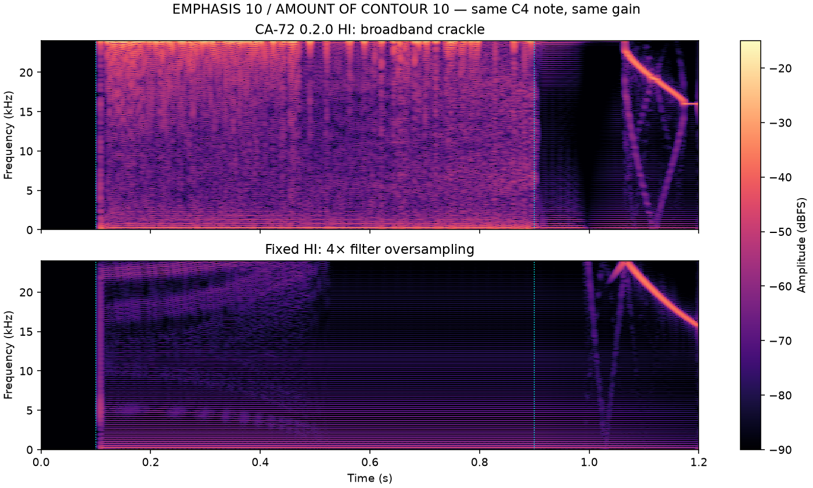
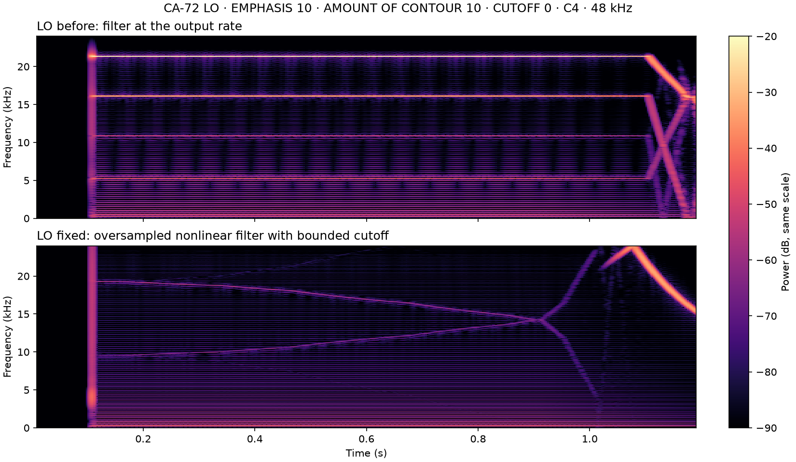

# Strong filter contours

Diagnostic spectrograms retained from the 2026-10-13 investigation (decisions.md R71).
These are model renders of the reported high EMPHASIS and AMOUNT OF CONTOUR settings,
not recordings of hardware. The old and fixed renders use a common gain.

The HI comparison is the released 0.2.0 filter at 2× against the fixed 4× filter.
The LO comparison is the released output-rate filter against the final 8× filter,
with its bounded nonlinear solver and saturated cutoff. The fixed DSP source is the
same as the 0.2.1 source; the editor and packaging changes do not alter these renders.

`crates/ca72-lab/tests/high_contour.rs` retains the whole-note, sample-rate, control
movement, ultrasonic-regeneration, cutoff-fit and paced CPU checks. The comparisons
measure unwanted high-frequency energy; they do not establish that LO has the same
complete spectrum as ULTRA or provide a new hardware calibration.
