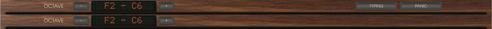
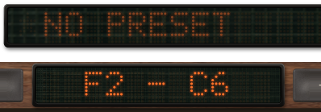

# Keyboard feedback

The keyboard toggle has three natural keys and two accidentals, centred in its existing button.


Held keys darken across their full surface, retaining their shading and texture. This applies
to both the realistic and drawn looks. Local presses are visible without waiting for an audio
callback, including when devices are disabled. The audio thread's held MIDI notes remain visible.

The renderer's C4 and C♯4, released on the left and held on the right:


Rendered at 0.44 and 0.87 pixels per artwork unit. Both natural and accidental surfaces darken;
neighbouring keys stay unchanged; release restores the complete frame exactly. The repaint check
compares with a fresh keyboard renderer rather than two caches with the same history.

The octave controls, range display, TYPING and PANIC share the visible wood's vertical centre.
The printed labels use the built-in font's visible glyph bounds instead of its em box. Rendering,
button materials and hit targets use the same header position. The TYPING mapping legend follows
that centre as well. The range reuses the preset display's bezel, glass asset, dot font, spacing
and orange light. The preset display's appearance is unchanged.

TYPING and PANIC sit side by side, with matching 230 × 48-unit caps and a 16-unit gap. Their
drawing, materials and click targets share one layout; both labels retain their vertical centre.
They appear only in the standalone application. Plug-ins keep the playable keys and octave
controls; TYPING, PANIC and the typing legend are absent, their old positions do nothing, and
computer-keyboard note input remains with the host. Visibility follows the actual host API,
including when a plug-in build includes standalone support. The Audio Unit wraps the CLAP.

Standalone header above, plug-in header below:



Preset display above, octave range below, from the same rendered frame:



Before above, centred header below:


Focused checks: 44 panel unit tests and the panel approval check passed, with 7 visual/timing
tests ignored; 5 playing tests and 9 keyboard/editor checks passed. The keyboard/editor checks
also passed with all features enabled, and the refused-expansion note-release check passed.
Clippy passed for both touched
crates, all targets, with and without all features; formatting passed. Full CI and native host
checks are deferred until visual review. This is a candidate, separate from released 0.2.1.

Independent read-only review of `f4f9eef` found no actionable issues and confirmed the unchanged
preset rendering, correct cache invalidation and supported root labels fitting the range screen.

The standalone integration also retains the independent C-root octave: the active
TYPING legend shows A's current note and Z/X. TYPING stays playable in controls and
compact views. The merged source passes 240 plug-in library tests (13 ignored),
45 panel tests (7 ignored), the panel approval check and strict Clippy with and
without optional features. To reproduce the combined active-keyboard render:

```sh
CA72_SKIN=worn CA72_KEYBOARD=1 CA72_STANDALONE=1 CA72_TYPING=1 CA72_KEYS_PLAYED=1 \
  cargo run -p ca72-panel --example png -- combined.png 0.44
```
