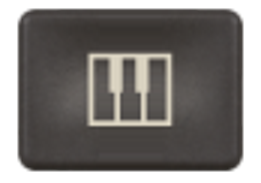
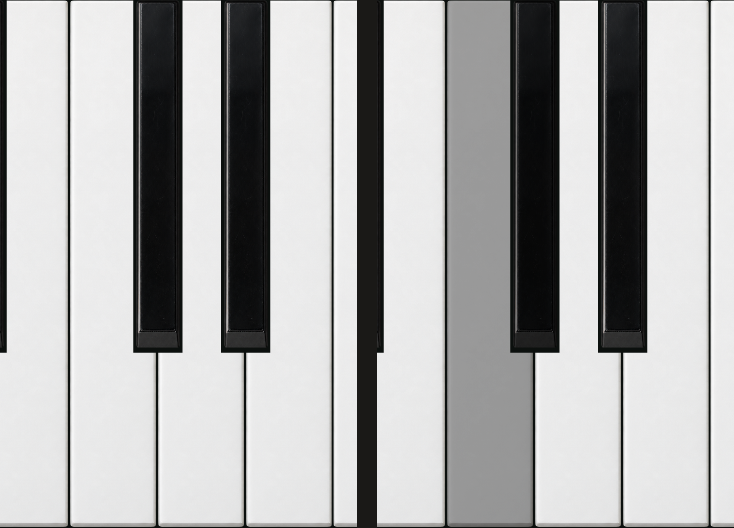
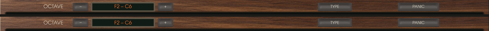

# Keyboard feedback

The keyboard toggle has three natural keys and two accidentals, centred in its existing button.

Held keys darken across their full surface, retaining their shading and texture. This applies
to both the realistic and drawn looks. Local presses are visible without waiting for an audio
callback, including when devices are disabled. The audio thread's held MIDI notes remain visible.

The renderer's C4 and C♯4, released on the left and held on the right:

Rendered at 0.44 and 0.87 pixels per artwork unit. Both natural and accidental surfaces darken;
neighbouring keys stay unchanged; release restores the complete frame exactly. The repaint check
compares with a fresh keyboard renderer rather than two caches with the same history.

The octave controls, range display, TYPE and PANIC share the visible wood's vertical centre.
Their labels use the built-in font's visible glyph bounds instead of its em box. Rendering,
button materials and hit targets use the same header position. The TYPE mapping legend follows
that centre as well.

Before above, centred header below:

Focused checks: 44 panel unit tests and the panel approval check passed, with 7 visual/timing
tests ignored; 5 playing tests and 6 keyboard/editor checks passed. Clippy passed for both touched
crates, all targets, with and without all features; formatting passed. Full CI and native host
checks are deferred until visual review. This is a candidate, separate from released 0.2.1.
