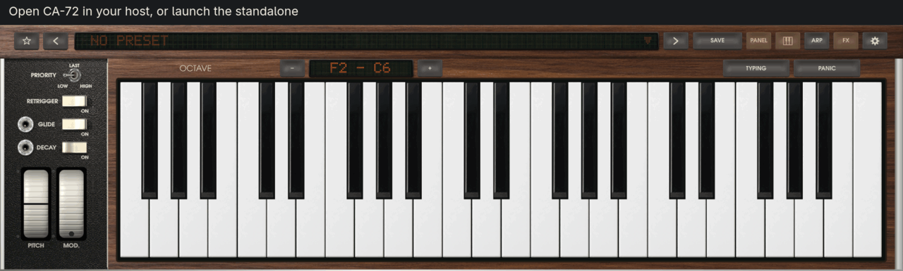
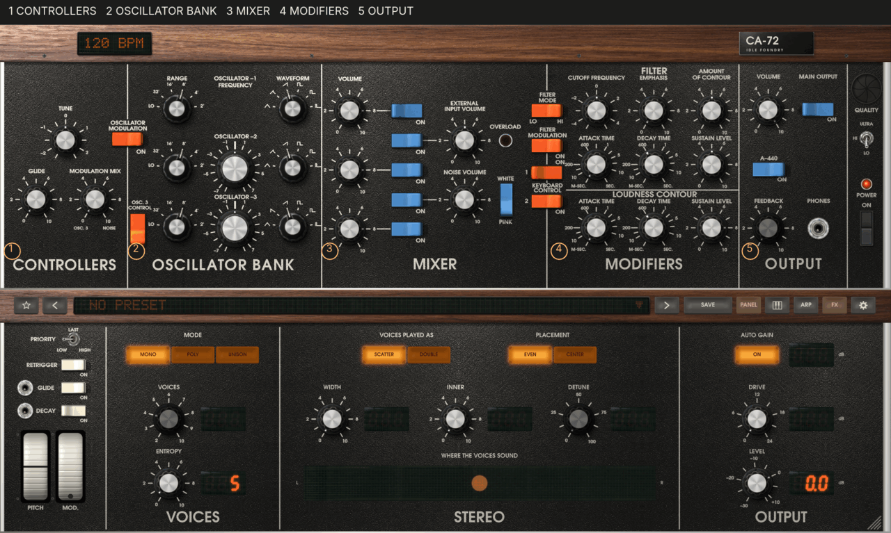
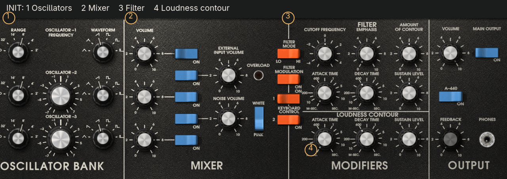
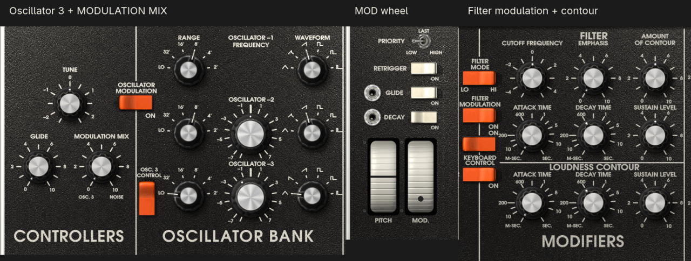
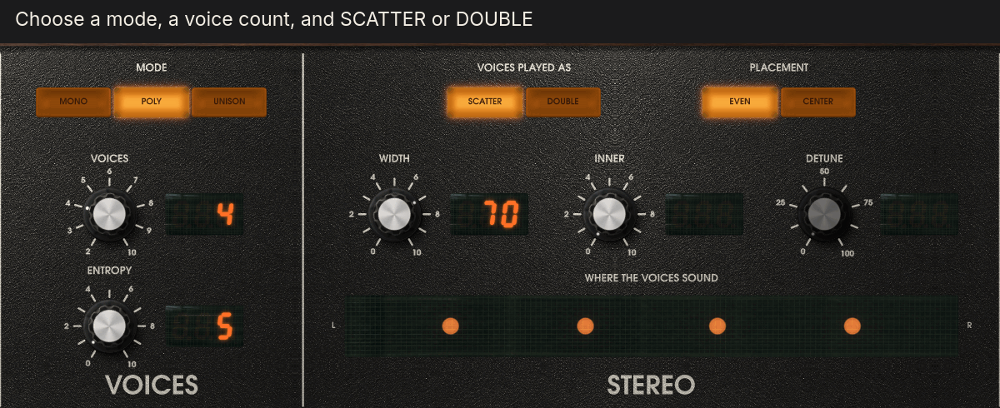
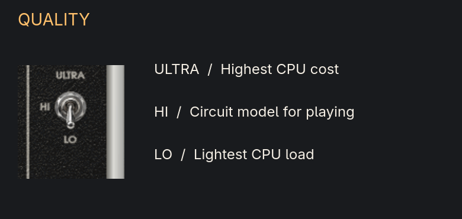
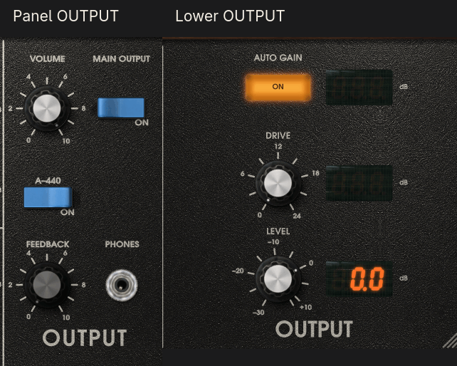
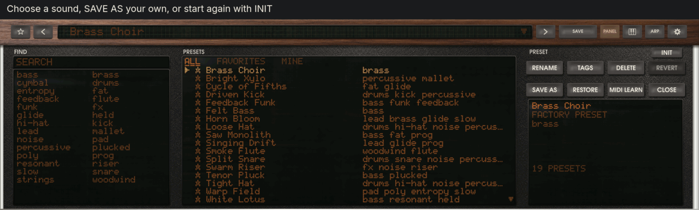
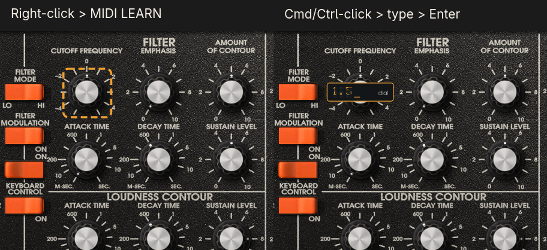
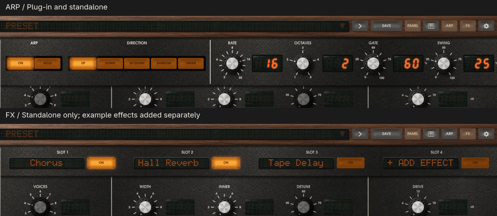

# CA-72 quick start

Your first few minutes with CA-72 0.3.0. These pictures use the default realistic look;
click one to see it larger.

## 1. Install and open

Follow the [installation instructions](../README.md#installing) for downloads and folders:
on **macOS**, run the `.pkg`; on **Windows**, run the setup `.exe`; on **Linux**, unpack the
archive and run `./install.sh`. Rescan plug-ins in your host, or restart it, then add CA-72
as an instrument. In Logic Pro and GarageBand, look under **AU Instruments › Idle Foundry**.

Or launch standalone and open **Audio & MIDI** from the settings gear: choose your output
and MIDI input, then Apply. Without a MIDI keyboard, click the lower keys or enable
**TYPING** in standalone (`A` is C, `W` is C-sharp, `S` is D).

## 2. The panel at a glance

Read the panel from left to right: **1 CONTROLLERS** sets tuning, glide and modulation;
**2 OSCILLATOR BANK** makes the waves; **3 MIXER** chooses and balances the sources;
**4 MODIFIERS** shapes their tone and loudness; **5 OUTPUT** controls the main output.

The wooden rail holds presets, **SAVE**, **PANEL**, the keyboard icon, **ARP**, and settings;
standalone adds **FX**. PANEL shows or hides the lower area; the keyboard icon swaps keys
and extra controls. Drag knobs vertically or scroll them; Shift-drag makes fine changes.
Hover for values, or choose **LETTERING › LARGE** in settings for larger print.

## 3. Make your first sound

Save any edits you want to keep, then click the preset name, press **INIT** beside PRESET,
and close the drawer. Play a note: Init is oscillator 1 alone, a sawtooth at **8′**, in **MONO**.

**1** Try **WAVEFORM** and **RANGE**. **2** Switch **OSCILLATOR-2** on in the mixer and balance
the **VOLUME** knobs. **3** Lower **CUTOFF FREQUENCY** for a darker tone; add **EMPHASIS** for
resonance and **AMOUNT OF CONTOUR** for movement from the filter envelope. **4** Shape the
note with **LOUDNESS CONTOUR**'s ATTACK, DECAY and SUSTAIN; the lower **DECAY** switch also
allows the contours to fade after key release.

## 4. Add vibrato: source, route, wheel

Start from Init:

1. Set oscillator 3's **RANGE** to **LO** and its **WAVEFORM** to the triangle (first
   position). Turn **OSC. 3 CONTROL** off so playing higher notes does not speed it up.
   Its **FREQUENCY** knob is now your vibrato rate control.
2. Leave oscillator 3's mixer switch off: it can modulate without being audible in the mix.
   Turn **MODULATION MIX** fully toward **OSC. 3** (counterclockwise).
3. Turn **OSCILLATOR MODULATION** on. Raise the **MOD.** wheel a little, on screen or on your
   MIDI controller for pitch vibrato.

MODULATION MIX blends **oscillator 3 and noise**; toward **NOISE**, modulation becomes
irregular even with the mixer's NOISE switch off. **FILTER MODULATION** sends the same
wheel-controlled signal to the filter. The **filter envelope** takes a separate path
through **AMOUNT OF CONTOUR**: it is not a MODULATION MIX source and needs neither the
MOD wheel nor FILTER MODULATION.

Settings' **MOD WHEEL SOURCE** chooses **CC 1** (default), another available CC such as an
expression pedal, channel aftertouch, or polyphonic aftertouch (the strongest held note,
moving one shared wheel). This is a computer preference, outside presets and projects.
The on-screen wheel and MIDI source use whichever value is higher: to remove modulation,
lower both.

## 5. One note, chords, or a stack

**MONO** plays one note at a time; **POLY** plays chords with up to **VOICES** instruments
(2 to 10); **UNISON** stacks that many instruments on one note. **SCATTER** places voices
across the stereo field using **WIDTH**, **INNER**, and **EVEN / CENTER**. In MONO, with
WIDTH up, detached notes move through those places too.

**DOUBLE** gives each note two voices, **DETUNE** apart (0 to 100 cents), and roughly
doubles their work. If chords crackle, try SCATTER, fewer VOICES, or QUALITY LO. Changing
mode or switching DOUBLE releases sounding notes.

## 6. Choose a quality your computer can play

Start at **QUALITY LO**, the light model and the default. **HI** uses the circuit model
for real-time playing and costs more CPU. **ULTRA** is the most exact and most expensive:
use it for offline export, bounce or freeze, or small projects on a powerful computer.
Costs vary with the patch and computer. Quality stays with your project or standalone
session, outside presets and Init; switching into or out of LO releases held notes.

## 7. Leave room for the peaks

The panel's **VOLUME** and **MAIN OUTPUT** switch control the main output; lower OUTPUT's
**LEVEL** sets final gain (−30 to +12 dB). Lower LEVEL to leave a few decibels below 0 dBFS
on your host's output meter, especially with chords.

**DRIVE** (0 to 24 dB) pushes the filter harder and changes its tone. **AUTO GAIN**
compensates for DRIVE's added loudness, not peaks. It remeasures after DRIVE or AUTO GAIN
changes in the editor, with DRIVE above zero, AUTO GAIN on and no notes held. **OVERLOAD**
meters the external-input path; check your host's meter for output peaks.

## 8. Find, save, and start again

Click the preset name, search or click a tag, then choose a sound; double-click to close
the drawer too. The rail's arrows step through the list, as do **Left / Right arrow keys**
when the editor receives them and no drawer, menu or text field is using them. Your host
may reserve these keys.

**SAVE** opens **SAVE AS**: enter a new name, optionally tags, then Enter or SAVE AS again.
Presets are shared between standalone and plug-in; a dot marks edits. **INIT** restores the
starting sound while keeping your presets, MIDI assignments and computer preferences.

## 9. Use a controller or type a value

Right-click a sound control, choose **MIDI LEARN**, then move your controller's knob or
fader: the first message assigns it, later ones move the sound control. Escape cancels
waiting; right-click again for **REMOVE MIDI ASSIGNMENT** or **MIDI ASSIGNMENTS…**. Learning
the MOD wheel chooses its computer-wide wheel source instead.

For an exact value, **Cmd-click** a knob on macOS or **Ctrl-click** on Windows and Linux,
type, then **Enter**; **Escape** cancels. Knobs use their printed scale, ATTACK and DECAY
use milliseconds (or an `s` suffix), and lower controls use displayed units. RANGE and
WAVEFORM selectors accept typed values too.

## 10. Open the drawers

Press **ARP**, switch **ON**, and hold a chord. Try **DIRECTION**, **RATE**, and **OCTAVES**;
**GATE** changes note length, **SWING** offsets every second step, and **HOLD** keeps the
chord going after release. Plug-ins follow host tempo; standalone has **TEMPO** at the
panel's top left. Closing the drawer leaves it running: turn HOLD off and release the
keys to stop; turn ON off to disable arpeggiation. With ON off, HOLD can sustain a drone.

Standalone's **FX** opens four slots after the synth, left to right. **+ ADD EFFECT** lists
your installed CLAP and VST3 effects (added separately). Click a name for its window, its
**ON** tab to bypass it, or right-click for **REPLACE… / REMOVE**. In a plug-in, use your
host's effects.

## If something is quiet or unexpected

- **No sound:** try Init, check MAIN OUTPUT and POWER, then your host's instrument/MIDI
  routing or standalone's Audio & MIDI choices. Click a lower key to check without hardware MIDI.
- **No vibrato:** check LO, OSC. 3 CONTROL off, MIX toward OSC. 3, OSCILLATOR MODULATION on,
  and the MOD wheel raised. Check MOD WHEEL SOURCE if only the hardware wheel does nothing.
- **A repeating or held note:** check ARP's ON and HOLD. In standalone, PANIC releases notes.
- **Crackles:** try LO, SCATTER, and fewer VOICES; check the audio buffer size in your host
  or standalone's Audio & MIDI settings.

For the full control reference, see [Instrument controls](../README.md#instrument-controls)
and [MIDI Learn](../README.md#midi-learn).
